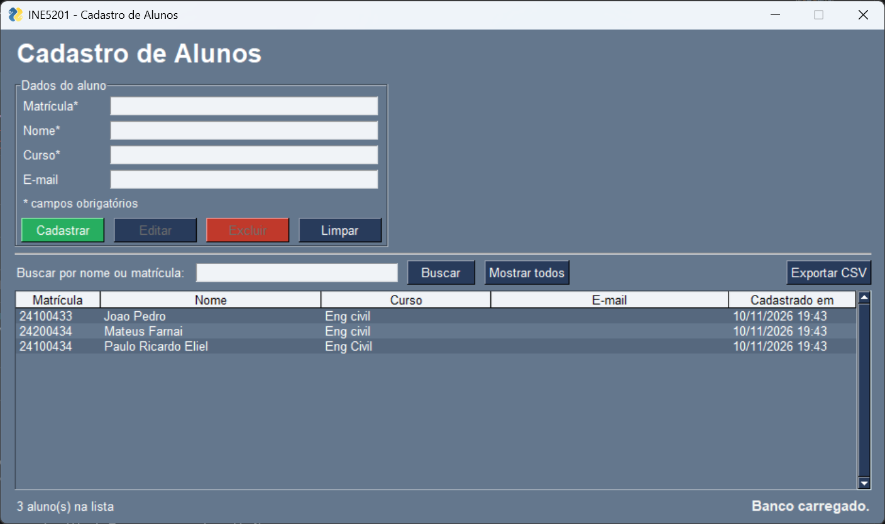
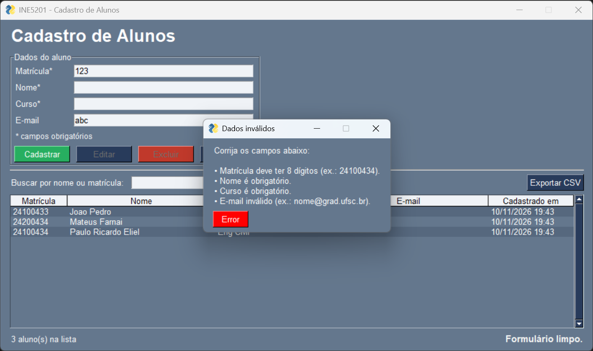
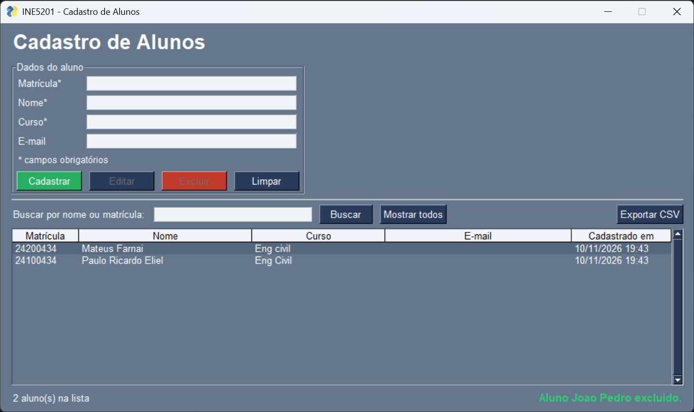

# Cadastro de Alunos

Tarefa 04 da disciplina **INE5201 - Introdução à Ciência da Computação com Python** (UFSC).

Sistema CRUD (cadastrar, consultar, editar e excluir) de alunos com interface gráfica em FreeSimpleGUI e armazenamento permanente em um banco SQLite. Os dados continuam salvos depois que o programa é fechado.

## Participantes

| Nome | Matrícula |
|---|---|
| Paulo Ricardo Eliel Mendes Peres dos Santos | 24100434 |
| Matheus da Silva Farani | 24202994 |

## Como executar

Requisito: Python 3.10 ou mais recente. O `sqlite3` já vem com o Python.

```bash
pip install -r requirements.txt
python cadastro_alunos.py
```

No Windows, se `python` não for reconhecido, use `py` no lugar. Na primeira execução o programa cria o arquivo `alunos.db` na mesma pasta, usando o script `banco.sql`.

## Arquivos

| Arquivo | Conteúdo |
|---|---|
| `cadastro_alunos.py` | Programa principal (banco, validações e interface) |
| `banco.sql` | Script SQL de criação da tabela `alunos` |
| `alunos.db` | Banco SQLite, criado automaticamente (não vai para o GitHub) |
| `requirements.txt` | Dependência: FreeSimpleGUI |

## Esquema do banco de dados

Banco SQLite `alunos.db` com uma tabela:

**Tabela `alunos`**

| Coluna | Tipo | Restrição | Descrição |
|---|---|---|---|
| `matricula` | `TEXT` | `PRIMARY KEY` | Matrícula de 8 dígitos; não pode se repetir |
| `nome` | `TEXT` | `NOT NULL` | Nome completo |
| `curso` | `TEXT` | `NOT NULL` | Curso do aluno |
| `email` | `TEXT` | opcional | E-mail; validado quando preenchido |
| `data_cadastro` | `TIMESTAMP` | `DEFAULT CURRENT_TIMESTAMP` | Preenchida pelo próprio banco no momento do cadastro |

Script de criação (`banco.sql`):

```sql
CREATE TABLE IF NOT EXISTS alunos (
    matricula     TEXT PRIMARY KEY,
    nome          TEXT NOT NULL,
    curso         TEXT NOT NULL,
    email         TEXT,
    data_cadastro TIMESTAMP DEFAULT CURRENT_TIMESTAMP
);
```

O `IF NOT EXISTS` permite rodar o script toda vez que o programa abre: na primeira vez ele cria a tabela, e nas próximas não faz nada, mantendo os dados.

**Comandos SQL usados por operação**

| Operação | SQL |
|---|---|
| Cadastrar (Create) | `INSERT INTO alunos (matricula, nome, curso, email) VALUES (?, ?, ?, ?)` |
| Listar e buscar (Read) | `SELECT ... FROM alunos WHERE nome LIKE ? OR matricula LIKE ?` |
| Editar (Update) | `UPDATE alunos SET nome = ?, curso = ?, email = ? WHERE matricula = ?` |
| Excluir (Delete) | `DELETE FROM alunos WHERE matricula = ?` |

Os `?` são parâmetros: o `sqlite3` insere os valores com segurança, então um texto digitado no formulário nunca é executado como comando SQL (proteção contra *SQL injection*).

## Como usar

| Botão | O que faz |
|---|---|
| **Cadastrar** | Valida o formulário e grava um aluno novo |
| **Editar** | Salva as alterações do aluno carregado no formulário |
| **Excluir** | Pede confirmação e apaga o aluno carregado no formulário |
| **Buscar** | Filtra a tabela por parte do nome ou da matrícula (também funciona com Enter) |
| **Mostrar todos** | Volta a mostrar a lista completa |
| **Limpar** | Esvazia o formulário e sai do modo de edição |
| **Exportar CSV** | Salva a lista exibida em um arquivo `.csv` que abre no Excel |

Para editar ou excluir, clique em um aluno na tabela: os dados dele vão para o formulário, a matrícula fica bloqueada (é a chave primária) e os botões **Editar** e **Excluir** são liberados.
O arquivo exportado usa ponto e vírgula como separador, o padrão do Excel em português.

## Validações

| Situação | Mensagem |
|---|---|
| Matrícula, nome ou curso vazios | "Matrícula é obrigatória.", "Nome é obrigatório.", "Curso é obrigatório." |
| Matrícula fora do formato | "Matrícula deve ter 8 dígitos (ex.: 24100434)." |
| Nome muito curto | "Nome deve ter pelo menos 3 letras." |
| E-mail em formato errado | "E-mail inválido (ex.: nome@grad.ufsc.br)." |
| Matrícula já cadastrada | "A matrícula ... já está cadastrada." |
| Busca sem resultado | "Nenhum aluno encontrado para ..." |
| Exclusão | Janela de confirmação "Excluir ... ? Essa ação não pode ser desfeita." |

A matrícula repetida é barrada duas vezes: o programa consulta o banco antes de inserir e, se mesmo assim o `INSERT` falhar, o `sqlite3.IntegrityError` causado pela `PRIMARY KEY` é tratado e vira uma mensagem de erro. Todos os erros aparecem em janelas de aviso e na barra de status, sem fechar o programa.

Antes de validar, os textos passam por `limpar_texto`, que remove espaços nas pontas e espaços repetidos, e o e-mail é convertido para minúsculas.

## Estrutura do código

```
cadastro_alunos.py
├── Constantes: caminhos, colunas da tabela e expressões regulares
├── Banco de dados
│   ├── criar_conexao(arquivo)
│   ├── criar_tabela(conexao, arquivo_sql)
│   ├── inserir_aluno(conexao, dados)
│   ├── buscar_aluno(conexao, matricula)
│   ├── atualizar_aluno(conexao, dados)
│   ├── excluir_aluno(conexao, matricula)
│   ├── listar_todos(conexao)
│   ├── pesquisar_alunos(conexao, termo)
│   └── exportar_csv(alunos, caminho)
├── Validação
│   ├── limpar_texto(texto)
│   └── validar_dados(dados)
├── Interface gráfica
│   ├── criar_layout()
│   ├── atualizar_tabela(window, alunos)
│   ├── ler_formulario(values) / preencher_formulario / limpar_formulario
│   └── mostrar_status / mostrar_erros
└── main(): abre o banco e roda o loop de eventos
banco.sql: criação da tabela alunos
```

**Transações.** As funções que alteram o banco usam `with conexao:`. Ao sair do bloco, o `sqlite3` faz o `commit` automaticamente; se ocorrer um erro no meio, ele desfaz a operação (`rollback`), então o banco nunca fica pela metade.

**Expressões regulares.** A matrícula é validada com `^\d{8}$` (exatamente 8 dígitos) e o e-mail com `^[\w.+-]+@[\w-]+(\.[\w-]+)+$` (texto, `@`, domínio e pelo menos um ponto).

## Screenshots

**Tela principal com alunos cadastrados**



**Validação de campos**



**Confirmação de exclusão**



## Uso do GitHub Copilot

Usei o chat do GitHub Copilot no VS Code, no modo **Ask** (só perguntas, sem deixar ele alterar os arquivos). Não pedi para ele criar o sistema; selecionei funções prontas e pedi explicações ou melhorias.

| Prompt | Função assistida | O que aproveitei ou mudei |
|---|---|---|
| "Explique o que fazem o "with conexao" e os "?" nesta função" | `inserir_aluno` | Usei a explicação para entender que o `with conexao` faz `commit` ao final ou `rollback` se der erro, e que os `?` enviam os valores separados do comando SQL, prevenindo SQL injection. Não alterei o código. |
| "Sugira melhorias para esta função de validação dos dados do aluno" | `validar_dados` | Aceitei contar só as letras do nome (`sum(letra.isalpha() ...)`), para que algo como `1 2` não passe como nome válido. Descartei usar `dados.get(...)` e limpar os textos de novo dentro da função, porque `ler_formulario` já entrega todos os campos limpos com `limpar_texto`. |
| "Como deixar esta tabela do FreeSimpleGUI mais fácil de usar?" | `criar_layout` (tabela) | Aceitei as linhas alternadas (`alternating_row_color`), mas corrigi a cor: a sugerida (`#EAF2F8`) é quase branca e o tema usa texto claro, então as linhas ficariam ilegíveis. Usei `#56687E`, um azul mais escuro. |

**Relato.** O Copilot ajudou em três funções: `inserir_aluno`, `validar_dados` e `criar_layout`. Em `inserir_aluno`, a explicação deixou claro como o `with conexao` controla a transação (commit ou rollback) e por que os `?` evitam SQL injection. Aceitei a sugestão de validar o nome contando só as letras, porque antes um texto como `1 2` passava pela verificação de tamanho. Na tabela, aceitei as linhas alternadas, mas precisei corrigir a cor sugerida, que era quase branca e deixaria o texto claro do tema ilegível. Descartei refazer a limpeza dos campos dentro de `validar_dados`, porque isso já é feito em `ler_formulario`. Aprendi que as sugestões precisam ser conferidas no contexto do programa, como o tema de cores e o que outras funções já fazem.

## Tecnologias

- Python 3
- [FreeSimpleGUI](https://pypi.org/project/FreeSimpleGUI/)
- SQLite (módulo `sqlite3` da biblioteca padrão)
- Bibliotecas padrão: `csv`, `os` e `re`
- GitHub Copilot
